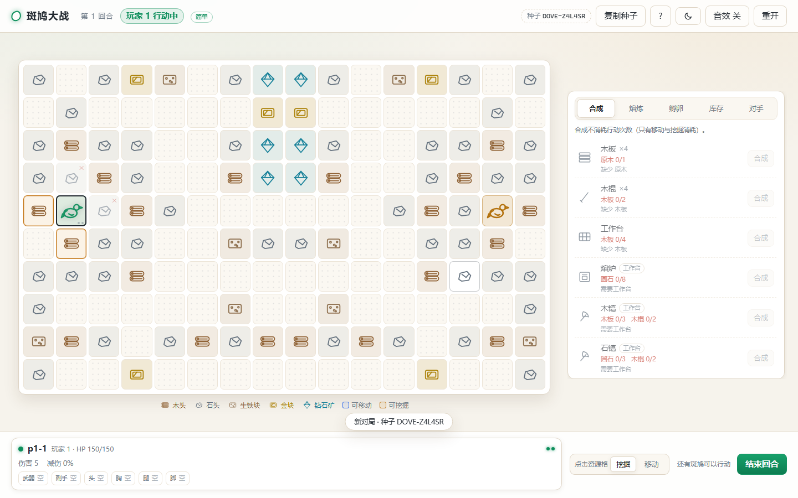
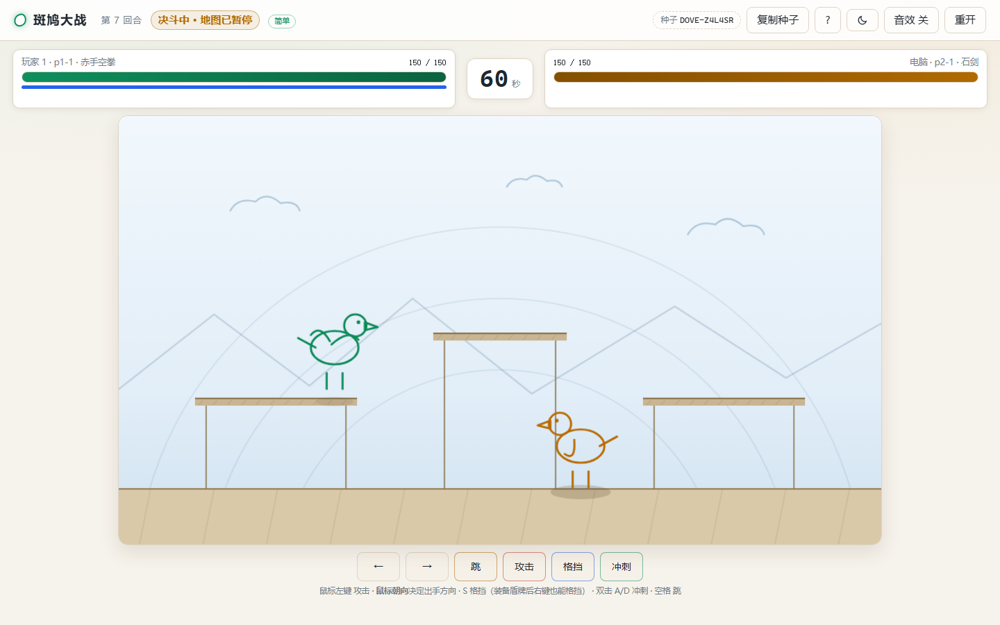
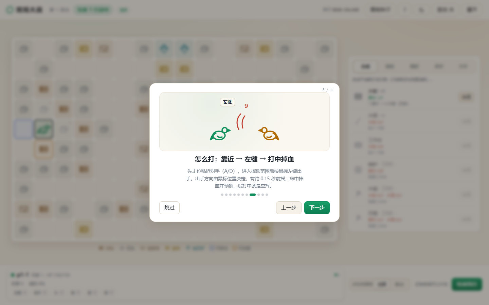
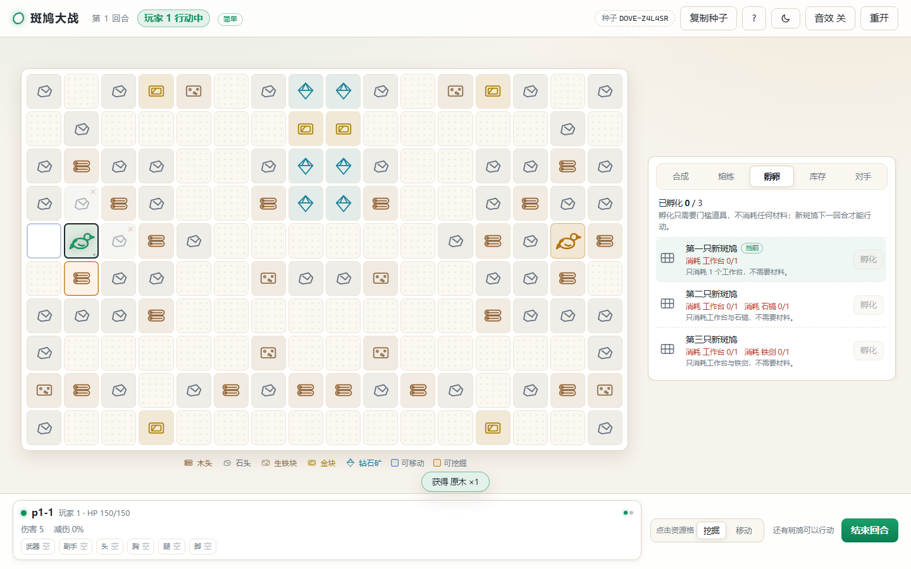

# 斑鸠大战 · Dove War

双人回合制资源争夺 + 横版 PvP 决斗的可玩原型。玩家操控斑鸠在 10×16 的随机地图上采集资源、按 Minecraft 配方制作工具与护甲，与电脑对手争夺地图；两只敌对斑鸠正交相邻时，立即进入限时 60 秒的横版决斗，败方斑鸠被摧毁。

规格来源：[TARGET.md](TARGET.md)；施工计划与决策记录：[PLAN.md](PLAN.md)。

**在线试玩（GitHub Pages）**：<https://mosaLacr1.github.io/dove_war/>

## 截图

| 地图（10×16，镜像生成） | 决斗（三层平台 + 跳跃） |
| --- | --- |
|  |  |

| 图文新手教程 | 孵卵面板（只消耗门槛道具） |
| --- | --- |
|  |  |

## 技术栈

React 19 + TypeScript + Vite 6；游戏逻辑全部在 `src/core/`，零 DOM 依赖，可用 Vitest 直接跑；
决斗场景用 Canvas 2D 绘制；没有后端、没有联网。82 项单元测试，GitHub Actions 跑类型检查 / 测试 / 构建。

## 快速开始

```bash
npm install
npm run dev      # http://127.0.0.1:5173
npm test         # 82 项单元测试
npm run build    # 类型检查 + 生产构建
```

> 本机环境注意：Node 为 v20.10.0，因此锁定了 `vite@^6`（Vite 7/8 要求 ≥20.19）。
> `.npmrc` 已把 npm 缓存指到项目内的 `.npm-cache/`，避免沙箱外写入被拒。
> `scripts/ui-check.mjs` 默认调用本机 Chrome，可用环境变量 `CHROME_PATH` 指定其他 Chromium。

## 部署

推送到 `main` 会触发 `.github/workflows/deploy-pages.yml`：`npm ci` → `npm run build` → 把 `dist` 发布到 GitHub Pages。
仓库首次启用时，需要在 Settings → Pages → Build and deployment → **Source 选择 GitHub Actions**（不要用 "Deploy from a branch"，否则会直接发布源码 `index.html`，线上白屏）。

Vite 的 `base` 设为 `'./'`，所以构建产物放在 `/<repo>/` 这样的子路径下也能正确加载 `assets`。

## 第一次玩

首次开始对局会自动弹出**图文新手教程**（11 页，带插画与逐条说明）：采集 → 科技线 → 熔炼 →
孵化 → 接敌 → 战斗 → 防守 → 盾反 → 键位速查。之后可以随时从顶栏的 `?` 或标题页的
「新手教程」重新打开。主题默认浅色，顶栏的月亮/太阳按钮可切换深色，选择会记住。

标题页可以选择**电脑难度**（简单 / 普通 / 困难），结算页也能换难度再来。

## 怎么玩

**地图阶段**

- 点击自己的斑鸠选中它（也会自动选中当前玩家一只有行动的斑鸠）。
- 点击相邻空格：移动 1 格，消耗 1 次行动；每只斑鸠每回合 2 次行动，用完自动换手。
- 点击相邻资源格：默认是**挖掘**；底栏「点击资源格：挖掘 / 移动」可切换成踩上去（资源不阻挡移动）。
- 右侧只有一个面板，用标签页切换：**合成 / 熔炼 / 孵卵 / 库存 / 对手**。
- 键盘：方向键移动、`Tab` 切换斑鸠、`E` 结束回合。

**决斗阶段**（场地分三层：地面、左右两个低台、中间高台）

| 操作 | 鼠标 / 键盘 | 触屏按钮 |
| --- | --- | --- |
| 移动 | `A` / `D`、`←` / `→` | ← → |
| 攻击 | **鼠标左键**（也可 `J` / `Z`） | 攻击 |
| 格挡 | **`S`**（也可 `K` / `Shift`） | 格挡 |
| 盾反 | **鼠标右键**（需副手装备盾牌） | 格挡 |
| 冲刺 | **双击 `A` / `D`**（也可 `L` / `X`） | 冲刺 |
| 跳跃（按住更高） | `空格`、`W`、`↑` | 跳 |
| 朝向 | **移动鼠标**：出手方向永远朝鼠标 | — |

- **完美格挡**：在对手命中前的 0.08 秒内按下格挡 → 不受伤害，并让对手硬直 0.45 秒。
- **盾反**：副手装备盾牌时，完美格挡会把 35% 伤害弹回去，硬直更长（0.6 秒）。
- 高低差超过 62px 就打不到对手：站高台能躲地面攻击，但也打不到下面的人。
- 手感细节：加速度/摩擦起步、命中顿帧 + 镜头抖动、可变跳跃高度、跳跃缓冲与土狼时间。

## 核心规则实现

| 规则 | 实现 |
| --- | --- |
| 地图 | 10 行 × 16 列，左右镜像生成；每侧木头 5 / 石头 10 / 生铁块 4 / 金块 3 / 钻石 3，外加随机填充，整体约 54% 格子有资源 |
| 资源 | 木头、石头、生铁块、金块、钻石矿；挖掘产物分别为原木、圆石、生铁块、金块、钻石 |
| 工具门槛 | 空手挖木头 / 木镐挖石头 / 石镐挖生铁块 / 铁镐挖金块与钻石 |
| 生铁链 | 生铁块 →(拆解) 9 生铁 →(熔炉) 铁锭。全程不出现原版「铁块」，避免与「生铁块」混淆 |
| 燃料 | 木板/原木 3 点、木棍 1 点作为燃料点（等价原版 1.5 / 0.5 个物品），每次熔炼扣 2 点 |
| 配方 | 集中式数据 `src/core/config/recipes.ts`，材料数量按 Minecraft Java 1.20.4；3×3 配方持有工作台即可用、不消耗 |
| 盾牌 | 6 木板 + 1 铁锭 → 盾牌，装在副手；格挡减伤从 ×0.3 提升到 ×0.2，并解锁盾反 |
| 新斑鸠 | 自定义配方，**只消耗门槛道具**：①工作台 ②工作台+石镐 ③工作台+铁剑；不需要任何材料。上限 3 只，孵化当回合不能行动 |
| 决斗触发 | 仅正交相邻；移动或孵化后立即检查；多组同时满足时按 pair 键字典序逐场处理；同 pair 冷却到脱离相邻为止 |
| 结算 | 击倒或时间到比血量；平局双方返回地图且不摧毁；败方装备不掉落；任意一方无斑鸠立即失败 |
| 装备 | 武器加伤（木 2 / 石 4 / 铁 6 / 钻 8），护甲按件减伤（四件约 25%），无法一击秒杀 |
| 难度 | 简单/普通/困难三档，同时影响决斗 AI（反应时间、格挡率、盾反率、伤害）与地图 AI（扩张节奏、操作速度） |
| 复现 | 全部随机走种子（mulberry32）；地图、决斗 AI、种子均可用同一种子完整复现，界面可复制种子 |

## 架构

```
src/core/            纯逻辑，零 DOM 依赖，可在 Node 中直接测试
  config/            balance.ts / items.ts / recipes.ts / doves.ts / difficulty.ts
  map/               grid / generate（镜像生成 + 配额）/ validate（连通性与开局可行性）
  combat/            duel.ts（60Hz 定步长：重力、跳跃、单向平台、顿帧、完美格挡、盾反）
                     ai.ts（难度档案驱动的决斗 AI：会跳台、格挡、盾反、后撤）
  ai/mapAi.ts        电脑对手的地图策略（规划 → 由 game.ts 执行）
  game.ts            顶层状态机与全部动作（移动/挖掘/合成/熔炼/孵化/装备/回合/决斗结算）
  adjacency.ts       触发检测、确定性排序、交战冷却
src/ui/              React 组件；只调用 core 暴露的动作与选择器
  components/SidePanel.tsx   右侧标签面板（合成/熔炼/孵卵/库存/对手）
  components/Tutorial.tsx    图文新手教程（11 页）
  theme.ts                   浅色/深色主题与持久化
scripts/ui-check.mjs 开发期自动化点测（puppeteer-core 驱动本机 Chrome，产出截图与报告）
tests/               Vitest，82 项
```

数据流是单向的：UI 读到 `GameState` → 调用 `core` 的纯动作 → 返回新的 `GameState`。UI 不持有规则。

## 测试覆盖

| 关注点 | 文件 |
| --- | --- |
| 地图生成、种子复现、镜像公平、资源密度与配额、1000 种子连通性校验 | `tests/map.test.ts` |
| 配方数量正确性、盾牌配方与副手装备、材料不足原子性、拆解、熔炼、新斑鸠门槛 | `tests/crafting.test.ts` |
| 行动消耗、移动/挖掘合法性、回合轮转、新斑鸠次回合生效 | `tests/turns.test.ts` |
| 正交/斜角触发、多组确定性顺序、冷却与清除、决斗后衔接 | `tests/adjacency.test.ts` |
| 完美格挡窗口、盾反反弹、格挡减伤、鼠标朝向、背对空挥、难度伤害 | `tests/parry.test.ts` |
| 三档难度都能被打赢、难度梯度递增 | `tests/difficulty.test.ts` |
| 决斗计时、平局、击倒、跳跃与平台、可变跳高、顿帧、确定性回放、平衡边界 | `tests/duel.test.ts` |
| 开局状态、同种子重开、电脑回合推进不卡死 | `tests/game-flow.test.ts` |

自动化点测（`node scripts/ui-check.mjs`，需 dev server 在跑）验证：首屏、三档难度选择与顶栏徽标、
教程自动弹出与逐页图文、160 格地图、挖掘反馈、五个标签页都有内容、配方按钮禁用态、
无空白按钮、主题切换、教程再次打开、音效开关、走到相邻触发决斗、鼠标左键攻击与跳跃、
决斗结算、返回地图/重开、窄屏无横向溢出且格子可点，截图输出到 `.tmp/shots/`。

## 已知范围与后续可做

- 仅支持人机对战；决斗模拟已提供 `stepBoth()`（双人同屏 / 测试用），但没有做本地双人 UI。
- 无存档，刷新即重开；重新开始会重新生成地图。
- 装备/工具不做耐久（不会用坏），因此工具只作为门槛与消耗品。
- 音效为 WebAudio 合成音，默认关闭。
- 电脑的地图策略是规则式的（缺什么采什么、够本再扩张），没有搜索。
- 数值都在 `src/core/config/balance.ts` 与 `src/core/config/difficulty.ts` 里单点可调。
